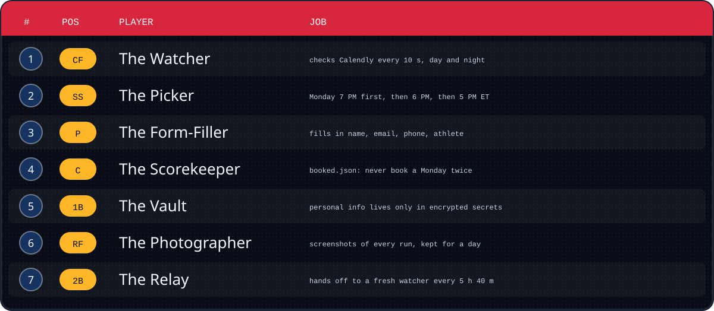
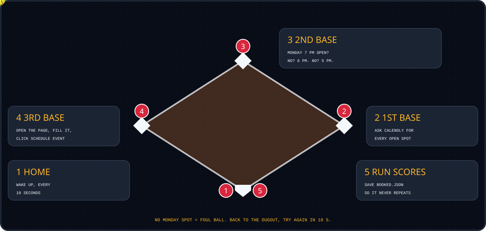
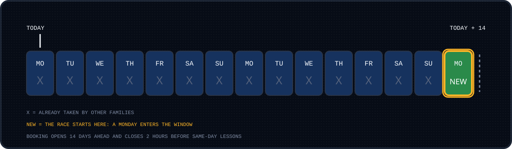
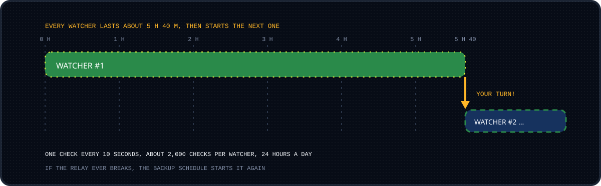
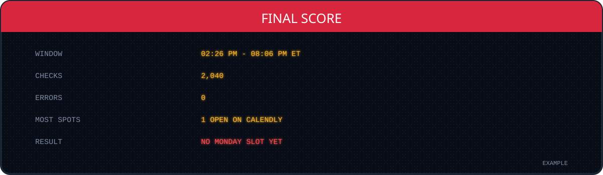
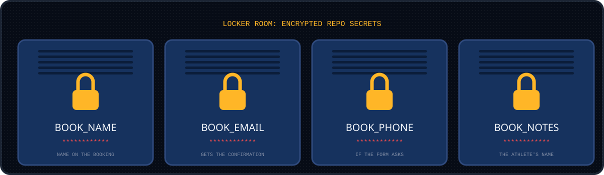

<p align="center">
  
</p>

<p align="center">
  <a href="../../actions/workflows/book.yml"></a>
  
  
  
  
</p>

<h3 align="center">🥎 Never miss a Monday pitching lesson again.</h3>

Coach Giana LaCedra's lessons fill up fast. This bot watches her
[Calendly page](https://calendly.com/gl-softball-lessons) around the clock, **every 10 seconds**, and books the
**Monday lesson between 5 and 7 PM (Eastern)** the moment one opens up.

If more than one time is open, it takes **the latest**: 7 PM first, then 6 PM, then 5 PM. If only one is
open, it takes that one.

<p align="center"></p>

## Quick start

1. **Add your secrets** (name, email, phone, player's name): see [05 Spring training](#05).
2. **Set two variables**: `EVENT_SLUG` = `individual-pitching-lesson-1` and `BOT_ENABLED` = `true`.
3. **Test it first**: `gh workflow run book.yml -f simulate_open_slot=true` (books nothing). See [06 Batting practice](#06).

That's all. The bot restarts itself every ~5 h 40 m, so there's nothing to keep running.

<a id="01"></a>
<p align="center"></p>

<p align="center"></p>

<a id="02"></a>
<p align="center"></p>

Every 10 seconds the bot runs the bases. If there's no Monday spot at 2nd base, that's a **foul ball**: back to the
dugout, and try again in 10 seconds.

<p align="center"></p>

<a id="03"></a>
<p align="center"></p>

Coach LaCedra's Calendly says *"Booking opens 14 days in advance and closes 2 hours before same-day lessons."*
So each Monday becomes bookable exactly two weeks ahead, at the far edge of the calendar, and everything inside
the window is usually gone already.

<p align="center"></p>

That's why the bot never sleeps: a Monday spot only shows up when a new day enters the window or when somebody
cancels, and either way the first family to click gets it.

<a id="04"></a>
<p align="center"></p>

GitHub's built-in schedule can run hours late, so every live run is a **watcher**: it checks Calendly every
10 seconds for about 5 h 40 m (just under GitHub's 6-hour job limit), books the moment a Monday 7, 6 or 5 PM
slot opens, then starts the next watcher itself. Only one watcher runs at a time, and the repo is public, so the
minutes are free.

<p align="center"></p>

The `*/5` schedule is just a backup: if the relay ever breaks, the next scheduled run starts it again. A watcher
that dies within 20 minutes doesn't relay, so a broken setup can't spin.

If Calendly ever starts refusing requests, the bot slows down by itself (up to one check every 2 minutes) and
speeds back up as soon as it's let in again.

Every run starts its log like this:

```text
Softball Lesson Bot
-------------------
  Mode         LIVE WATCH
  Target       Monday 7 PM, else 6 PM, else 5 PM ET (latest open slot wins)
  Look ahead   15 days
  Check every  10 s for 340 min

WATCH: checking every 10s for 340 min
[11-22 06:31 AM ET] check #1: 1 open spot(s), no Monday slot yet
[11-22 06:36 AM ET] check #30: 1 open spot(s), no Monday slot yet
...
```

and ends with a **final score**, also shown on the run's summary page:

<p align="center"></p>

Restart the relay by hand: `gh workflow run book.yml -f dry_run=false`

<a id="05"></a>
<p align="center"></p>

<p align="center"></p>

**Secrets** live under *Settings → Secrets and variables → Actions → Secrets*. Nothing personal is ever written
into the code.

| Secret | What it is |
|---|---|
| `BOOK_NAME` | Name on the booking |
| `BOOK_EMAIL` | Email that gets the confirmation |
| `BOOK_PHONE` | Phone number, used if the form asks for one |
| `BOOK_NOTES` | Player's name, typed into the "Athletes name" question |

**Variables** (same page → *Variables*)

| Variable | What it does |
|---|---|
| `EVENT_SLUG` | Which lesson type to book. Set to `individual-pitching-lesson-1`. Every run's log lists the available types. |
| `BOT_ENABLED` | `true` lets the bot book for real. Anything else pauses every real booking, however the run was started. |
| `WATCH_INTERVAL` | *Optional.* Seconds between checks. Defaults to `10`. |

**Change the day or the times** by editing two lines at the top of `book.py`:

```python
TARGET_WEEKDAY = 0                 # Monday (Mon=0 ... Sun=6)
PREFERRED_HOURS = (19, 18, 17)     # 7 PM first, then 6 PM, then 5 PM: the latest open slot wins
```

<a id="06"></a>
<p align="center"></p>

| Test | Command | What you get |
|---|---|---|
| ⚾ **Dry run** | `gh workflow run book.yml -f dry_run=true` | Fills the real form for an open slot and saves `form.png`. Doesn't submit. |
| 🎯 **Simulated opening** | `gh workflow run book.yml -f simulate_open_slot=true` | Pretends the next Monday slot is open. Fills the real Calendly form (`real_form.png`, no submit), then runs the whole flow, including *Schedule Event*, against a local copy of the form (`mock_form.png`, `confirmed.png`). |

Screenshots appear under the run's **Artifacts → screenshots**.

<a id="07"></a>
<p align="center"></p>

```bash
gh variable set BOT_ENABLED --body false               # stops the relay after the current watcher
gh run list --workflow book.yml --status in_progress   # then cancel the running watcher now:
gh run cancel <run id>
gh workflow disable book.yml                           # or switch the workflow off completely
```

Back on the field: `gh variable set BOT_ENABLED --body true` (or `gh workflow enable book.yml`).

<a id="08"></a>
<p align="center"></p>

| File | What it does |
|---|---|
| `.github/workflows/book.yml` | The watcher relay and the backup schedule |
| `book.py` | Finds the slot, fills the form, books it |
| `booked.json` | The dates already booked, so none is booked twice |
| `tests/mock_booking.html` | A Calendly-style form for practice runs |
| `assets/build_assets.py` | Draws the banner, headers and diagrams |
| `assets/*.svg` | The artwork you see in this README |

<p align="center"></p>

<p align="center"><sub>Made for one softball family. Books at most one lesson per Monday. 🥎</sub></p>
<p align="center"><sub>Fonts: <a href="https://fonts.google.com/specimen/Bungee">Bungee</a> by David Jonathan Ross and
<a href="https://fonts.google.com/specimen/Press+Start+2P">Press Start 2P</a> by CodeMan38, both under the SIL Open Font License.</sub></p>
