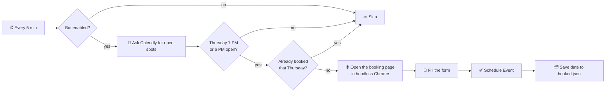

<p align="center">
  
</p>

<p align="center">
  <a href="../../actions/workflows/book.yml"></a>
  
  
  
  
</p>

<h3 align="center">🥎 Never miss a Thursday pitching lesson again.</h3>

Coach Giana LaCedra's lessons fill up fast. This bot watches her
[Calendly page](https://calendly.com/gl-softball-lessons) around the clock and books
the **Thursday 7:00 PM (Eastern)** lesson as soon as it opens up. If 7 PM is taken, it
grabs **6:00 PM** instead.

---

## ✨ What it does

| | |
|---|---|
| ⏱️ **Checks every 5 minutes** | [cron-job.org](https://cron-job.org) starts the GitHub Action, with GitHub's own schedule as a backup, so nothing runs on your computer |
| 🎯 **Targets the right slot** | Thursday 7 PM ET first, 6 PM ET as the fallback, up to 15 days ahead |
| 📝 **Fills the form like a person** | Name, email, phone, and the player's name in the *Athletes name* question |
| 🔁 **Never double-books** | Every booked date goes into [`booked.json`](booked.json) and is skipped afterwards |
| 🔒 **Keeps personal info private** | Everything personal lives in encrypted repo secrets, never in the code |
| 📸 **Shows its work** | Screenshots of each run are saved as a downloadable artifact for one day |

## 🧭 How it works



## ⚙️ Setup

**Secrets** (*Settings → Secrets and variables → Actions → Secrets*)

| Secret | What it is |
|---|---|
| `BOOK_NAME` | Name on the booking |
| `BOOK_EMAIL` | Email that gets the confirmation |
| `BOOK_PHONE` | Phone number, used if the form asks for one |
| `BOOK_NOTES` | Player's name, typed into the "Athletes name" question |

**Variables** (same page → *Variables*)

| Variable | What it does |
|---|---|
| `EVENT_SLUG` | Which lesson type to book. Set to `individual-pitching-lesson-1`. Every run's log lists the available types. |
| `BOT_ENABLED` | `true` lets the bot book for real. Anything else pauses every real booking, however the run was started. |

## ⏰ The 5-minute timer

GitHub's built-in schedule can lag or skip on busy days, so a free [cron-job.org](https://cron-job.org) job
starts the workflow every 5 minutes instead:

| Setting | Value |
|---|---|
| URL | `https://api.github.com/repos/lenzebest-max/softball-lesson-bot/actions/workflows/book.yml/dispatches` |
| Method | `POST` |
| Headers | `Authorization: Bearer <fine-grained token, Actions: read & write on this repo only>`<br>`Accept: application/vnd.github+json`<br>`Content-Type: application/json` |
| Body | `{"ref":"main","inputs":{"dry_run":"false"}}` |

GitHub replies `204 No Content` when the run has started.

## 🧪 Testing without booking

| Test | Command | What you get |
|---|---|---|
| **Dry run** | `gh workflow run book.yml -f dry_run=true` | Fills the real form for an open slot and saves `form.png`. Doesn't submit. |
| **Simulated opening** | `gh workflow run book.yml -f simulate_open_slot=true` | Pretends next Thursday 7 PM is open. Fills the real Calendly form (`real_form.png`, no submit), then runs the whole flow, including *Schedule Event*, against a local copy of the form (`mock_form.png`, `confirmed.png`). |

Screenshots appear under the run's **Artifacts → screenshots**.

## ⏸️ Turning it off

```bash
gh variable set BOT_ENABLED --body false   # pause all real bookings
gh workflow disable book.yml               # or switch the workflow off completely
```

Turn it back on with `gh variable set BOT_ENABLED --body true` (or `gh workflow enable book.yml`).

## 🗂️ Files

```
📁 .github/workflows/book.yml   the 5-minute schedule
🐍 book.py                      finds the slot and fills the form
🗒️ booked.json                  Thursdays already booked
🧪 tests/mock_booking.html      Calendly-style form for the simulation
🎨 assets/banner.svg            the banner above
```

<p align="center"><sub>Made for one softball family. Books at most one lesson per Thursday. 🥎</sub></p>
